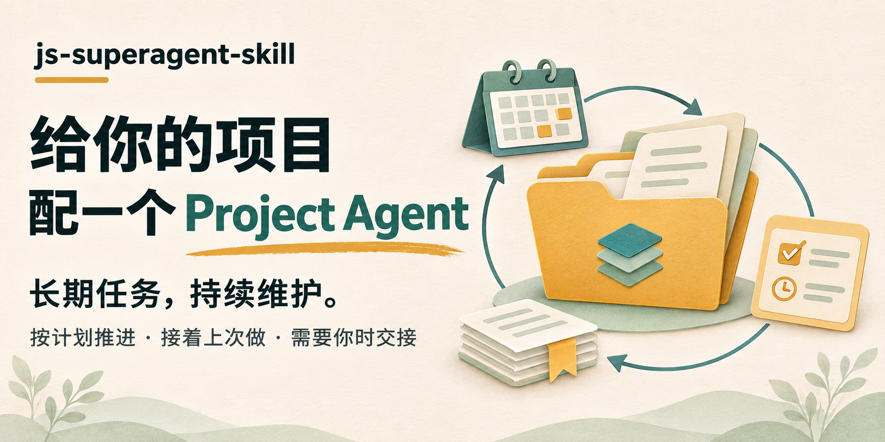
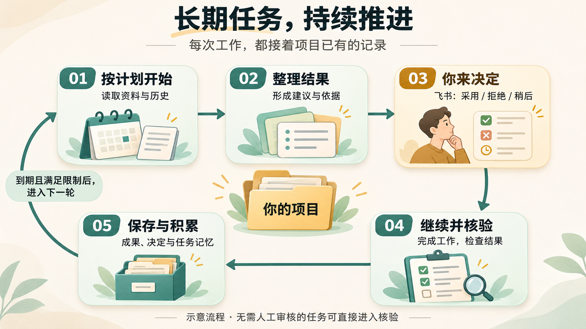
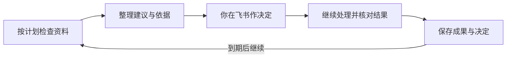
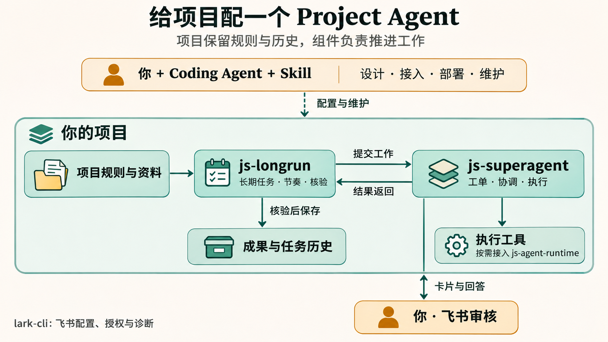

<div align="center">

# js-superagent-skill



持续维护长期任务，保留工作进度，需要你时再交接。

A Project Agent for ongoing work.

[](https://github.com/imjszhang/js-superagent-skill/actions/workflows/check.yml)
[](https://github.com/imjszhang/js-superagent-skill/tags)
[](LICENSE)

[它能做什么](#让长期任务持续推进) · [使用示例](#举个例子持续维护一份资料清单) · [开始使用](#给你的项目配上-agent) · [工作原理](#背后如何运作)

</div>

**Personal Agent 通常围绕人的事务提供帮助；本项目强调的是 Project Agent——围绕一个项目的目标、规则和进度持续工作。**

你可以交给它需要长期维护的任务：定期整理资料、持续更新报告、维护一批待审建议。它按配置开展工作，保存每次的结果和决定，遇到需要你判断的地方再交接，之后接着推进。

`js-superagent-skill` 帮你把这样的 Agent 接入自己的项目。你通过 Codex、Claude Code 等工具使用这个 Skill，由 Coding Agent 完成环境接入、任务设计、部署和检查；接入后的长期工作由项目后台运行。

## 让长期任务持续推进

长期任务往往没有“一次做完”这回事。资料会更新，建议需要取舍，上次搁置的内容还可能值得重新处理。Project Agent 维护的是这些**跨越多次执行、持续积累的工作**。

| 你关心的事 | Project Agent 如何配合 |
|---|---|
| **到时候继续做** | 按设定的间隔检查并开展下一轮工作，同时遵守次数、时间和暂停限制 |
| **接着上次做** | 保存任务输入、结果和决定，后续工作可以沿用已有记录与任务记忆 |
| **需要我时找我** | 把待审内容发到飞书，你作出决定后，原任务继续处理；“稍后”项可再次送审 |
| **随时看进度、调方向** | 查看哪些在执行、哪些等审核；调整后续任务配置，暂停新一轮或排查失败原因 |

**一个项目可以维护多项长期任务，每项有自己的进度和成果。** 例如，一项任务整理资料变化，另一项维护待审建议；它们可以共用项目的执行环境。

这里的“记住”来自项目文件、任务历史和保存的工作记录。你能查看这些积累，也能继续修改项目规则。

## 举个例子：持续维护一份资料清单

*下面是通用示例，用来说明工作方式。*

假设你在维护一个研究项目，希望定期从项目已有资料中整理出值得跟进的内容。你可以这样说：

```text
为这个项目建立一个长期任务：
每周检查我放进项目的资料，整理值得跟进的建议，说明依据。
结合已有建议和处理记录，检查是否重复。
需要我决定的内容发到飞书，让我选择采用、拒绝或稍后。
保存结果，下一次继续。先帮我把规则和运行方式配置好。
```

完成接入并启用任务后，它按照这样的流程工作：



<details>
<summary>查看可编辑流程图</summary>



</details>

选择“稍后”的内容会保留，等你决定重审时再送来。无需逐项审核的报告任务，则可以完成后直接核对并保存。

你也可以随时回来问：

> “这个项目现在有哪些任务在等我？”
>
> “把这项任务改为每两周一次。”
>
> “重新审核上次暂存的建议。”
>
> “为什么这次没有完成？检查原因，保留已有进度。”

持续维护的价值在于：**工作有下一步，决定有记录，成果留在项目里。**

## 适合交给它什么

| 想长期维护的工作 | 当前接入方式 |
|---|---|
| 定期整理资料变化，更新一份报告 | 内置本地资料报告任务 |
| 维护建议清单，持续收集人的取舍 | 内置候选审核任务，支持再次审核 |
| 持续搜集外部信息、跟进选题或研究方向 | 接入项目的搜索、来源核查和业务规则 |
| 其他项目专属流程 | 由 Coding Agent 协助设计，并接入所需工具与验收规则 |

内置任务可以从你提供的本地资料开始；联网搜索和专门业务需要额外接入。普通的一次性工作也可以交给工单执行。[任务设计说明 →](skills/js-superagent-skill/references/tasks.md)

## 给你的项目配上 Agent

**这个 Skill 是接入和维护 Project Agent 的入口。** 它指导 Coding Agent 安装缺失依赖、设计任务、配置执行与飞书审核，并验证完整流程。

### 1. 安装 Skill

在目标项目中，把下面这段话交给 Codex 或 Claude Code：

```text
从 https://github.com/imjszhang/js-superagent-skill 安装 v0.5.2 的
skills/js-superagent-skill/ 到当前项目的技能目录。
检查已有同名技能，保留本地修改，并在技能目录外记录来源版本与提交。
安装后读取该技能，检查本项目规则和现有任务，说明目前能做什么，
推荐最值得先做的一步，并给出我可以直接发送的下一句。先不启动任务。
```

<details>
<summary>手动安装位置</summary>

从指定标签复制整个 `skills/js-superagent-skill/`，保留相对路径。

| 使用工具 | 项目内位置 |
|---|---|
| Codex | `.agents/skills/js-superagent-skill/` |
| Claude Code | `.claude/skills/js-superagent-skill/` |
| 已有集中技能管理的项目 | 安装到项目维护源，再通过项目生成器生成入口 |

只安装技能目录；仓库根目录的 README、架构文档、测试和版本记录留在上游仓库。

</details>

### 2. 告诉它要长期维护什么

还没想好从哪开始，可以直接说：

```text
使用 js-superagent-skill，看看这个项目有哪些适合长期维护的工作。
结合已有资料和任务，推荐最值得先做的一项，说明会产出什么、还缺什么。
```

已有明确目标时：

```text
使用 js-superagent-skill，给这个项目接入 Project Agent。
我希望它长期负责：[你的目标]。
先读取相关项目规则，检查现有环境，再帮我设计和部署第一项任务。
```

Agent 会检查并安装兼容的依赖，明确任务输入、成果、频率和审核方式，再配置运行。涉及账号登录或本人验证时，由你在官方页面完成。

**安装和部署完成后，会告诉你接下来可以做什么。** 只有技能时说明还需检查的环境；后台就绪但没有任务时，结合项目推荐第一项维护工作；已有任务时，给出针对当前进度的查看、调整或审核建议。每次提供可直接使用的下一句；已有明确授权的工作会连续完成。[首次使用引导 →](skills/js-superagent-skill/references/onboarding.md)

部署还会在项目专属运行时目录准备 `knowledge/project.md`，说明项目目标、业务术语和资料入口。目录中的每个 Markdown 都作为协调者的一项知识；编辑后重启生效，Worker 不加载这组专属内容。已有文档保留，不强制建立第二套工作流或进度台账。[项目知识接入 →](skills/js-superagent-skill/references/knowledge.md)

### 3. 验证后启用，后续继续通过对话维护

让 Agent 核对任务执行、人工审核和结果保存。启用后，继续用同一个 Skill 查看状态、增加任务、调整规则或排查问题。

**运行需要一台保持可用的机器、已配置的执行器和后台服务。** 当前组合基线需要 Node.js ≥ 22.13；飞书审核还需应用及权限。完成后台部署后，任务可以在当前聊天结束后继续；机器休眠、关机或服务停止会影响运行。[安装与配置 →](skills/js-superagent-skill/references/setup.md)

## 背后如何运作

Project Agent 是这些组件在你的项目中的组合。**项目保存业务规则与历史，运行组件推进任务，Skill 帮助你搭建和管理它们。**



| 组件 | 在项目中做什么 | 项目 |
|---|---|---|
| 工单与执行 | 记录要做的事，安排 Agent 执行，接收人的回答 | [js-superagent](https://github.com/imjszhang/js-superagent) |
| 长期任务 | 记住每项任务的进度，决定何时继续，核对并保存成果 | [js-longrun](https://github.com/imjszhang/js-longrun) |
| 执行适配 | 按需要调用具体的 Agent 工具 | [js-agent-runtime](https://github.com/imjszhang/js-agent-runtime) |
| 飞书接入 | 配置账号、检查权限和排查飞书问题 | [lark-cli](https://github.com/larksuite/cli) |

js-agent-runtime 按需使用。日常卡片和回答由 js-superagent 的飞书通道处理；lark-cli 用于接入与诊断。

开发者可进一步阅读[组件架构图](docs/project-architecture.md#组件架构图)、[审核到结果保存的时序图](docs/project-architecture.md#审核结算时序图)和[状态归属说明](docs/project-architecture.md#状态归属与目录)。

### 设计来源

本项目借鉴 [dsh-superagent-prototype](https://github.com/deepseek-ai/dsh-superagent-prototype) 的持久工单、协调与执行分工、人工注意力管理思想。js-superagent 的领域核心基于其固定提交提取并适配；本 Skill 将相关组件组织为面向项目长期工作的接入与维护方式。

## 当前能力与边界

- **持续工作有规则。** 任务按配置和授权运行，不会自动替项目决定所有新目标。暂停后续运行与取消正在执行的工作是不同操作。
- **人的决定会被保留。** “稍后”项可显式重审；系统不会替你作出审核决定，也不会因此自动对外发布。
- **完成还要核对。** 审核提交后，任务继续执行；结果经过检查才写入项目。状态变化触发及时收集，定时检查作兜底。
- **仍需按项目验收。** 技能版本为 `0.5.2`，相关运行包仍包含 alpha 版本。已有测试不代表你的账号、工具和业务流程已经接通。

## 文档与参与

| 你想做什么 | 从这里开始 |
|---|---|
| 使用技能 | [Agent 操作入口](skills/js-superagent-skill/SKILL.md) |
| 接入自己的项目 | [安装与配置](skills/js-superagent-skill/references/setup.md) |
| 设计新的长期任务 | [任务设计](skills/js-superagent-skill/references/tasks.md) |
| 查看进度、恢复任务 | [运行维护](skills/js-superagent-skill/references/operations.md) · [飞书接入](skills/js-superagent-skill/references/feishu.md) |
| 了解实现 | [项目级架构与设计依据](docs/project-architecture.md) |
| 开发与升级技能 | [维护指南](docs/maintaining.md) · [变更记录](CHANGELOG.md) |

欢迎在 [Issues](https://github.com/imjszhang/js-superagent-skill/issues) 分享你想长期交给项目 Agent 的工作。反馈问题时，请只提交脱敏后的复现步骤。开发检查：`npm ci --ignore-scripts && npm run check`。任务说明模板、可验证定义示例和维护验收记录见[维护指南](docs/maintaining.md)。

## 致谢与许可

感谢 [dsh-superagent-prototype](https://github.com/deepseek-ai/dsh-superagent-prototype) 提供设计与领域核心参考。js-superagent 保留了[上游来源及许可声明](https://github.com/imjszhang/js-superagent/blob/main/THIRD_PARTY_NOTICES.md)。本技能独立维护，不是 DeepSeek 或飞书的官方产品。

[MIT License](LICENSE)
