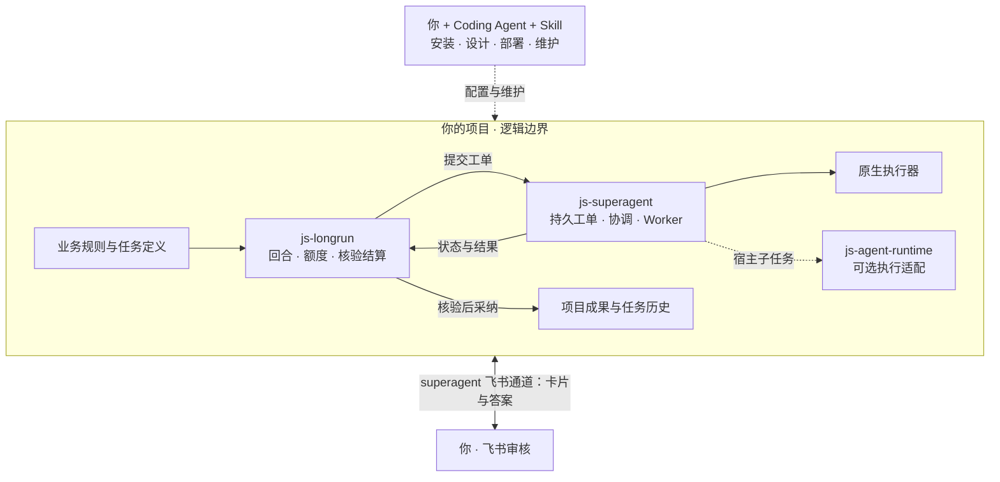
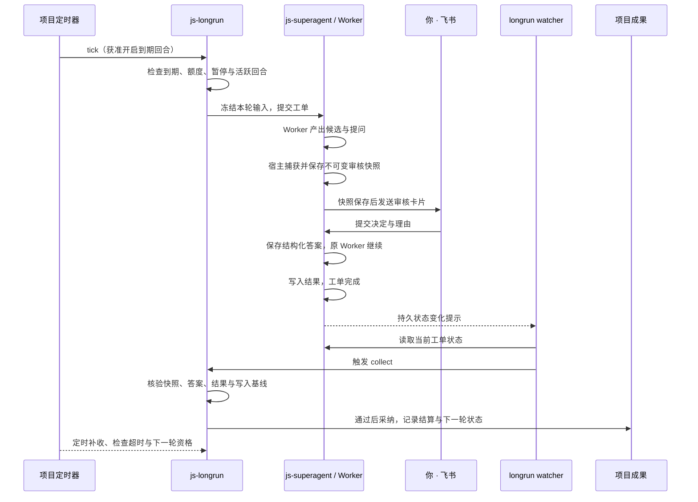

<div align="center">

# js-superagent-skill

**把持续工作交给项目，把关键决定留给你。**

A project-level operating skill for persistent agents.

[](https://github.com/imjszhang/js-superagent-skill/actions/workflows/check.yml)
[](https://github.com/imjszhang/js-superagent-skill/tags)
[](LICENSE)

[快速开始](#快速开始) · [项目级架构](#项目级架构) · [任务如何推进](#任务如何推进) · [关联项目](#关联项目) · [设计说明](docs/project-architecture.md)

</div>

让 Codex、Claude Code 等 Coding Agent 帮你**安装依赖、设计任务、配置持续运行、接入飞书审核，并验证结果是否真正落到项目中**。

从 [dsh-superagent-prototype](https://github.com/deepseek-ai/dsh-superagent-prototype) 的持久工单、协调与执行分工、人工注意力管理思想出发，把工作组织到**你的项目**：项目拥有业务规则、任务实例和成果；通用组件负责执行与推进；Skill 帮你完成接入和维护。

> **你可以这样开始：**“为这个项目建立每周资料报告任务，记录来源，标出值得跟进的内容，需要我判断时通过飞书审核。”
>
> Agent 会先落实任务定义和运行条件，再按授权部署。联网采集等业务能力由项目接入，内置任务从你提供的本地资料开始。

## 为什么需要它

一次对话可以完成一次工作。持续项目还要回答：**下一轮何时开始？上一轮做到哪里？谁来审核？结果是否已经采纳？**

本技能帮助你把这些问题落实成可检查的项目流程：

| 你想完成的事 | 技能帮助建立的能力 |
|---|---|
| 让工作持续推进 | 配置后台、到期检查、额度与暂停规则，按条件开启下一轮 |
| 把决定留给自己 | 用飞书卡片收集结构化审核，再继续原工单 |
| 接着上次做 | 保留工单、冻结输入、历史决定与下一轮记忆 |
| 知道结果能否使用 | 区分卡片送达、答案保存、工单完成和业务结算 |
| 给新项目复用 | 通用包负责运行，项目保留自己的规则、适配器和成果 |

**先接入一个任务，再逐步扩展。** 普通工单可直接用 js-superagent；长期任务加上 js-longrun；额外执行适配和飞书能力按需接入。

## 快速开始

### 1. 安装技能

让你的 Coding Agent 执行：

> 从 https://github.com/imjszhang/js-superagent-skill 安装 v0.2.1 的 `skills/js-superagent-skill/`。只复制可安装目录；检查已有同名技能，保留本地修改，并在技能目录外记录来源版本和提交。

| 客户端 | 项目内安装位置 |
|---|---|
| Codex | `.agents/skills/js-superagent-skill/` |
| Claude Code | `.claude/skills/js-superagent-skill/` |
| 已有集中技能管理的项目 | 安装到项目维护源，再用该项目的生成器生成入口 |

也可手动从指定标签复制整个目录，保留相对路径。仓库根目录的测试、版本记录与文档无需安装。

### 2. 告诉它你的项目目标

```text
使用 js-superagent-skill，为当前项目接入持续任务系统。
先检查现有环境，安装缺失且兼容的依赖。
帮我设计一个每周整理本地资料的任务：输出带来源的变化报告，
把需要我决定的事项单独列出，再配置运行与审核方式。
```

技能会指导 Agent 检查环境、安装所需包、明确任务输入与成果、配置执行器和渠道，最后进行分层验收。需要本人登录或验证时，你在官方页面完成；其余已授权操作由 Agent 继续。

### 3. 持续使用

```text
检查本项目所有长期任务：哪些在执行、哪些等我审核、哪些结算失败？
确认飞书提交后的自动收集正常，保留现有工单和审核状态。
```

**运行条件：**当前组合基线需要 Node.js ≥ 22.13、可用的执行器及账号；飞书需要相应应用与权限。安装技能本身不启动服务。后台服务、watcher 和定时器部署并获准运行后，工作才能在当前对话结束后继续。[安装说明 →](skills/js-superagent-skill/references/setup.md)

## 项目级架构

**一个项目，自己的规则、任务和历史。** Skill 在部署与维护时帮助你操作，持续运行由组件和宿主调度承担。



实线表示任务与审核流，虚线表示配置或可选接入。图中的“项目”是归属边界：superagent 状态按项目隔离，默认存放在用户状态目录；longrun 任务与业务成果留在宿主项目。普通工单可以直接进入 superagent，不必经过 longrun。

**分工的核心：**Skill 指导操作者，superagent 持有工单，longrun 推进长期任务，项目决定什么结果值得采纳。js-agent-runtime 是可选执行接口；lark-cli 用于飞书接入和诊断，生产卡片与回调由 superagent 处理。

[深入了解状态归属、部署组成与设计依据 →](docs/project-architecture.md)

## 任务如何推进

以“收集候选 → 飞书审核 → 采纳结果”为例。业务采集由宿主提供；下图描述已启用任务、后台和 watcher 后的流程。



**卡片提交 ≠ 工单完成 ≠ 业务结算。** watcher 会在相关状态变化后尽快触发收集，无需等到下一次定时检查；只有工单完成且核验通过，结果才被采纳。watcher 只收集，开启新回合由获准的定时检查负责。服务中断或核验失败时保留状态，由兜底检查或操作者继续处理。

这里的“结算”是把经过验证的结果写入项目，并更新回合、额度与记忆。它不代表自动对外发布。[运行维护 →](skills/js-superagent-skill/references/operations.md)

## 可以设计哪些任务

| 场景 | 起点 | 项目需要提供 |
|---|---|---|
| 资料变化报告 | `change-report@1` | 本地资料、报告目标与证据要求；无需逐项审核 |
| 建议或候选审核 | `review-items@1` | 本地输入、候选标准；支持采用、拒绝、稍后及重新审核 |
| 联网选题、研究或内容流水线 | 宿主业务适配器 | 采集/制作能力、业务校验和成果写入规则 |
| 一次修复或整理 | 普通 superagent 工单 | 任务范围、执行能力与验收要求 |

这些是复用入口，不是四个“一键业务应用”。**先定义成果，再选择执行方式。** 新业务可以通过宿主适配器扩展；内置长期任务当前只处理提供的本地输入。[任务设计 →](skills/js-superagent-skill/references/tasks.md)

## 关联项目

| 项目 | 负责什么 | 在这里的角色 |
|---|---|---|
| **[js-superagent](https://github.com/imjszhang/js-superagent)** | 项目级持久工单、协调执行、人工输入、可选 GitHub / 飞书渠道 | 执行与协作基础 |
| **[js-longrun](https://github.com/imjszhang/js-longrun)** | 长期任务、回合、额度、冻结输入、核验与结算 | 持续任务层 |
| **[js-agent-runtime](https://github.com/imjszhang/js-agent-runtime)** | 规划、探测并调用具体 Agent | 可选的宿主执行适配 |
| **[lark-cli](https://github.com/larksuite/cli)** | 飞书配置、授权、查询与诊断 | 飞书接入与维护工具 |
| **[dsh-superagent-prototype](https://github.com/deepseek-ai/dsh-superagent-prototype)** | 单 GitHub 仓库的 super-agent 研究原型 | 设计来源；js-superagent 的领域核心基于其固定提交提取并持续适配 |

### 从原型到项目级组合

我们借鉴上游的三项原则：**减少人工注意力消耗、让工单独立于执行会话、把人工判断变成明确的任务输入**。在此基础上，通过独立组件和宿主业务适配，组织项目中的持续工作。

| 上游原型的重心 | 本项目的落点 |
|---|---|
| 围绕一个 GitHub 仓库协作 | 围绕宿主项目的业务目标、资料、规则与成果协作 |
| DSH 主会话协调，执行会话工作 | Skill 指导部署；运行时协调者与 Worker 按项目配置执行 |
| 事件、授权、工单与反馈 | 在工单之上增加长期任务的回合、额度、审核核验与结算 |
| 操作者安装和维护部署 | 把接入、设计、检查、恢复流程交给使用本技能的 Coding Agent |

这描述的是组合方式与职责变化，不表示复刻了上游全部实现或研究设想。来源与逐项设计依据见[架构说明](docs/project-architecture.md#设计来源与证据)。

## 当前状态与边界

技能当前版本 **0.2.1**，MIT 开源；关联运行包仍包含 alpha 版本。已验证组合记录在[安装说明](skills/js-superagent-skill/references/setup.md)，安装时还会检查目标项目兼容性。

- **已有能力**：操作指引、只读依赖检查脚本、独立安装校验，以及关联包提供的工单、回合和审核链路。
- **需要部署**：执行器与登录、飞书应用、后台服务、一个项目 watcher 和兜底定时器；自定义业务需要宿主适配器。
- **验收范围**：本仓库 CI 检查技能文件与工具；每个目标项目仍需验证真实执行、卡片提交和业务结算。工作区隔离不等于操作系统沙箱，结算恢复不承诺跨系统 exactly-once。

## 文档与参与

| 想了解 | 从这里开始 |
|---|---|
| Agent 如何使用技能 | [SKILL.md](skills/js-superagent-skill/SKILL.md) |
| 安装、执行器与账号 | [安装与配置](skills/js-superagent-skill/references/setup.md) |
| 设计新任务 | [任务设计](skills/js-superagent-skill/references/tasks.md) |
| 检查与恢复运行 | [运行维护](skills/js-superagent-skill/references/operations.md) · [飞书接入](skills/js-superagent-skill/references/feishu.md) |
| 理解架构与上游关系 | [项目级架构](docs/project-architecture.md) |
| 修改、升级与发布技能 | [维护与版本管理](docs/maintaining.md) · [CHANGELOG](CHANGELOG.md) |

欢迎通过 [Issues](https://github.com/imjszhang/js-superagent-skill/issues) 分享任务场景或可复现问题，也欢迎提交改进操作流程与测试的 PR。请附组件版本、预期行为与脱敏复现步骤。

开发检查：`npm run check`。只读检查目标项目：

```sh
node skills/js-superagent-skill/scripts/inspect.mjs --project /absolute/target/project
```

可安装内容仅位于 `skills/js-superagent-skill/`；README、架构文档、测试、CI 与版本管理留在仓库层。[目录与版本规则 →](docs/maintaining.md)

## 致谢与许可

感谢 [dsh-superagent-prototype](https://github.com/deepseek-ai/dsh-superagent-prototype) 提供设计与领域核心参考。js-superagent 保留了[上游来源及许可声明](https://github.com/imjszhang/js-superagent/blob/main/THIRD_PARTY_NOTICES.md)。本技能独立维护，不是 DeepSeek 或飞书的官方产品。

[MIT License](LICENSE)
