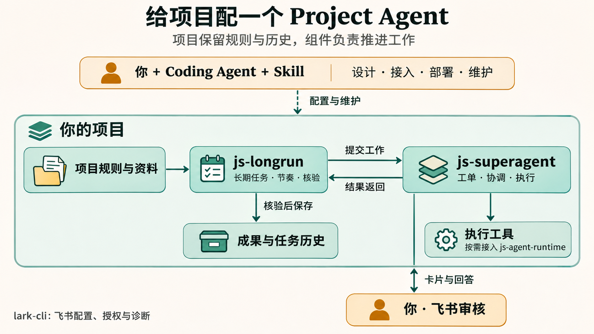
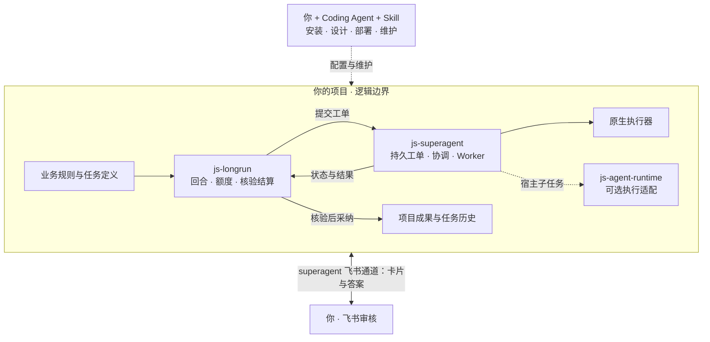
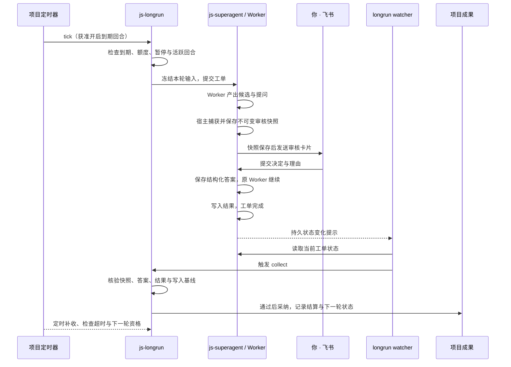

# 项目级持续任务：架构与设计依据

[返回 README](../README.md)

本说明面向希望将持续 Agent 工作接入现有项目的维护者。基于 2026-11-10 对上游原型、关联项目文档及关键实现的核对；描述当前组合方式，不把研究设想当作已交付能力。

材料与执行环境扩展的部署合同见[项目材料与执行环境](../skills/js-superagent-skill/references/materials.md)。它延续既有工单/Assignment：协调者保存原请求与路由，Worker 判断技术步骤，宿主核验材料授权、执行 generation、验证与输出；skill 通过公开配置接入，longrun 保持冻结输入及成果结算所有权。knowledge 仍只供协调者理解项目，不变成授权库或实时材料。

## Project Agent 的定位

本项目用 Project Agent 描述一种以项目为中心的工作方式：相关输入、规则、长期任务和成果各有归属，执行跨越多次会话，人工决定与历史持续保留。这是产品服务范围的定义，不是一个新增模型或独立的第五个运行包。

Personal Agent 常以个人为服务入口，例如 [OpenClaw 的项目介绍](https://github.com/openclaw/openclaw)围绕用户自己的设备和沟通渠道展开。本项目把介绍重心放在项目及其长期任务；这是一种使用视角，不用来断言其他助手无法处理项目工作。

长期维护由几项实际机制支撑：

| 用户价值 | 实现依据 |
|---|---|
| 项目有自己的运行身份与历史 | [项目身份](https://github.com/imjszhang/js-superagent/blob/main/src/project-identity.mjs)按真实项目路径绑定状态 |
| 同一任务可以按条件继续 | [任务定义](https://github.com/imjszhang/js-longrun/blob/main/src/core/definitions.mjs)保存运行间隔、限制与控制状态 |
| 后续工作可以沿用已有积累 | [任务类型装配](https://github.com/imjszhang/js-longrun/blob/main/src/types/index.mjs)读取已有任务记忆，运行时冻结每轮输入 |
| 一个项目容纳多项任务 | [项目调度](https://github.com/imjszhang/js-longrun/blob/main/src/project.mjs)逐项检查与收集，任务定义与成果按实例分开 |
| 回答之后继续原任务 | superagent 保存人工答案并续接工单，longrun 对结果进行核验和采纳 |

“长期”指按配置持续维护任务，并不意味着无限运行、无限记忆或自动发现全部项目目标。更改任务配置不会重写已经冻结的历史回合；暂停后续回合也不自动取消正在执行的工单。

README 的资料清单是通用示例，不披露任何使用者的项目、任务数据或验收记录。

## 组件架构图

图片展示主要职责与数据流；虚线表示配置维护。下方折叠的原始图保留完整执行分支。框内是项目的逻辑归属边界，实际数据位置见下文。



<details>
<summary>查看完整可编辑架构图</summary>



</details>

Skill 指导 Coding Agent 操作；后台的协调者与 Worker 属于 js-superagent。普通工单可直接进入 superagent，长期任务才需要 longrun。lark-cli 用于配置、授权与诊断；生产卡片和回调走 superagent 通道。

## 为什么以项目为边界

一个长期目标往往横跨多次会话、工单与人工决定。项目需要保存业务标准、输入、正式成果和历史；执行器负责当前工作，不能仅凭一次对话的结束判断项目目标已经完成。

这里有三种不同生命周期：

| 对象 | 生命周期与职责 | 持有者 |
|---|---|---|
| 操作会话 | 安装、配置、设计、排障与验收 | 使用本技能的 Coding Agent |
| 工单与执行会话 | 执行一次授权工作，等待人工输入，继续或结束 | js-superagent 与所配置执行器 |
| 长期任务与回合 | 决定何时开工、冻结输入、核验成果、更新额度和下一轮记忆 | js-longrun 与宿主业务适配器 |

关闭操作会话后，已部署服务可以继续运行；仅安装技能、仅创建任务或仅保存配置都不会建立这样的后台。Skill 是可版本化的操作知识与辅助工具，运行能力由关联组件提供。

## 谁决定什么

| 项目配置或实现 | 通用组件执行的约束 |
|---|---|
| 目标、输入、成果位置与完成标准 | 校验定义，冻结本轮配置和输入 |
| 运行间隔、回合限制、超时与暂停 | 开轮前检查到期、授权、额度和已有活跃回合 |
| 是否逐项审核、候选标准与业务含义 | 持久化结构化回答，核对原审核快照与答案 |
| 自定义采集、制作、验收与写入逻辑 | 工单执行、结果收集、锁、结算记录与恢复路径 |
| 执行器、账号、允许渠道和受管子任务 | 按显式配置调用能力，保留任务与会话归属 |

回合是一次有界尝试，不等于整个长期目标完成。额度控制已定义的回合、任务数量和时间边界，不是精确的 token 或账单预算。内置 `review-items@1` 与 `change-report@1` 面向本地输入；联网调研、内容制作等由宿主提供业务适配或可信子任务。[任务类型与运行说明](https://github.com/imjszhang/js-longrun/blob/main/README.md)

## 状态归属与目录

“项目级”指逻辑归属，不要求所有数据都存放在 Git 仓库。

```text
js-superagent-skill 仓库
├── skills/js-superagent-skill/   可安装操作技能
├── docs/                        项目架构、维护说明
└── test/、scripts/、.github/     开发、版本校验、CI

你的项目
├── 项目业务规则与输入            由项目自行组织
├── 业务适配器 / 调度入口         按需实现
├── research/longrun/<task-id>/   任务定义、回合与审核历史
├── working/longrun/             运行辅助数据
└── 正式成果                     通过业务核验后写入

用户状态目录（默认，可配置）
└── ~/.js-superagent/projects/<路径编码>/
    └── 工单数据库、配置、执行记录与工作区
```

宿主技能安装清单放在 `skills/installations/` 等管理目录，记录来源标签、提交与哈希。业务实例、账号、候选和审核决定不复制到技能仓库。详情参见 [superagent 项目状态说明](https://github.com/imjszhang/js-superagent/blob/main/README.md)和 [longrun 集成说明](https://github.com/imjszhang/js-longrun/blob/main/docs/integration.md)。

## 部署组成

| 组件 | 运行角色 | 不承担什么 |
|---|---|---|
| Coding Agent + Skill | 按用户任务检查、配置与维护 | 不常驻调度，不另建状态库 |
| superagent 服务 | 工单执行、配置的协调能力与渠道处理 | 不判断全部宿主业务成果是否可采纳 |
| longrun watcher | 观察持久状态变化，唤醒收集与核验 | 不开启新回合 |
| 项目兜底定时器 | 补收、超时检查；获准时开到期回合 | 不直接执行模型或绕过开轮检查 |
| 宿主业务适配器 | 业务输入、定制执行、验证和成果写入 | 不复制另一套工单运行时 |

`tick` 默认只收集和检查；显式允许开轮后才会开启合格回合。使用自定义业务路由时，watcher 和定时器都应调用注册了同一组路由的宿主入口。一个项目保持一个生产 watcher 与一个兜底定时入口，具体频率由项目配置；“每小时”是部署选择，不是包的固定协议。

js-agent-runtime 提供一次执行尝试的 `plan`、`probe`、`run` 等接口，可供宿主适配器或可信子任务使用。superagent 自身也能直接调用其原生执行器，不能把 runtime 画成所有工单必经的一层。[runtime 文档](https://github.com/imjszhang/js-agent-runtime/blob/main/README.md)

## 审核与即时结算

需要逐项审核的任务按以下顺序处理：

1. Worker 产生待审内容，宿主指定的证据文件在发卡前被捕获保存。
2. superagent 人工通道发送卡片，核对操作者、问题、消息身份和提交信息后保存结构化答案。
3. 原 Worker 获得回答，继续完成工作并写入结果。
4. watcher 收到状态变化提示，重新读取真实状态并调用收集。
5. longrun 对照冻结输入、审核快照、答案、结果范围和现有成果基线，核验后采纳并记录结算。

lark-cli 用于飞书的配置、授权、查询和诊断；生产发卡与回调走 superagent 人工通道。当前审核入口以配置操作者的私信为边界，不应描述成任意群聊多人审批。Worker 完成通知也不等于业务已结算通知。

状态变化提示可能重复、合并或遗漏，因此事件驱动负责及时响应，持久状态负责事实，定时检查负责兜底。多文件写入有恢复和冲突处理，但不是跨系统 exactly-once 事务。[状态观察机制](https://github.com/imjszhang/js-superagent/blob/main/docs/state-watch.md) · [longrun watcher 实现](https://github.com/imjszhang/js-longrun/blob/main/src/project.mjs) · [审核快照实现](https://github.com/imjszhang/js-superagent/blob/main/src/runtime/attention-snapshots.mjs)

### 审核结算时序图

以下描述已部署后台、watcher 和定时器，且已授权运行的审核任务。



卡片提交、工单完成和业务结算是三个不同事实。watcher 在状态变化后尽快收集，无需等到下一次定时检查；核验通过后才采纳结果。业务结算不等于对外发布。

## 从上游保留哪些思想

| 原型思想 | 项目级应用 | 边界 |
|---|---|---|
| 减少人的注意力消耗 | 把部署与检查交给 Agent，把关键判断留给人 | 不承诺完全无人值守 |
| 工单独立于执行会话 | 会话结束后仍能依据工单和历史追溯工作 | 恢复必须检查真实状态和已有外部动作 |
| 授权与上下文分离 | 输入资料提供上下文，任务授权决定允许的工作 | 文本范围不是操作系统安全边界 |
| 人工决定有结构 | 卡片答案与本次问题、证据关联 | 不从一段自由文本猜测逐项审核决定 |
| 明确状态写入归属 | 工单归 superagent，回合结算归 longrun，业务规则归项目 | Skill 不直接手改状态库来“修复”结果 |

上游侧重一个 GitHub 仓库中的 DSH 协作。js-superagent 从其固定提交提取领域核心，并在独立项目中实现存储、执行器与渠道适配；本 Skill 再组织这些组件的安装与操作方法。longrun 的回合、额度和业务结算是这一组合中的长期任务层，不应归因于上游已交付的全部功能。

## 设计来源与证据

以下是本次架构说明的主要来源。上游原型明确说明它是研究代码，公开版不等同于内部系统或文章中的全部设想。

| 来源 | 作者 / 维护者 | 本文使用的证据 |
|---|---|---|
| [原型 README](https://github.com/deepseek-ai/dsh-superagent-prototype/blob/main/README.md) | DeepSeek | 单仓库定位、Agent 辅助安装、研究原型边界 |
| [000 Philosophy](https://github.com/deepseek-ai/dsh-superagent-prototype/blob/main/docs/000-philosophy.md) | DeepSeek | 注意力、明确授权、领域概念与实现分工 |
| [001 Domain](https://github.com/deepseek-ai/dsh-superagent-prototype/blob/main/docs/001-domain.md) | DeepSeek | 工单独立于执行器，授权和上下文区别，结构化人工输入 |
| [003 Execution](https://github.com/deepseek-ai/dsh-superagent-prototype/blob/main/docs/003-execution.md) | DeepSeek | 持久执行、副作用记录、恢复与重试 |
| [007 Architecture](https://github.com/deepseek-ai/dsh-superagent-prototype/blob/main/docs/007-architecture.md) | DeepSeek | 状态归属、领域与宿主组合边界 |
| [js-superagent 来源清单](https://github.com/imjszhang/js-superagent/blob/main/docs/upstream-core.json) | imjszhang | 固定上游提交、提取文件与后续局部适配 |
| [js-longrun 集成约定](https://github.com/imjszhang/js-longrun/blob/main/docs/integration.md) | imjszhang | 宿主路由、状态保留、SDK 观察与定时器接入 |
| [js-agent-runtime](https://github.com/imjszhang/js-agent-runtime) | imjszhang | 执行适配而非工单或业务编排层 |
| [lark-cli](https://github.com/larksuite/cli) | Lark 团队 | 飞书操作 CLI 的定位 |

本次还对照了各包 README、技能 references、superagent 的卡片/快照实现及 longrun 的 watcher/collect 实现。旧阶段架构文档与现行代码不一致时，不以旧能力清单作承诺。

核对快照（2026-11-10）：原型本地 `8c32a9d`，js-superagent `f1e7262`，js-longrun `e550ae6`，js-agent-runtime `3b30a42`；js-superagent 核心最初提取的上游提交为 `6337fc8`。这些是本次调研证据版本，不表示推荐安装未发布的源码提交。部署使用的验证基线仍以[技能安装说明](../skills/js-superagent-skill/references/setup.md)为准。
